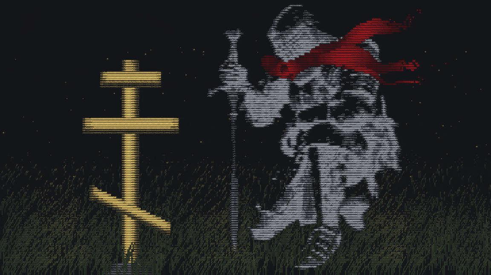

# Hey, I'm Justin

Full-Stack Developer who likes turning ideas into working software and digging into hard technical problems.

Outside of code, I'm drawn to industrial and defense tech. Especially how software powers automation and security in critical settings.

Always learning, always building, and aiming to work on things that actually matter.

<p align="center">
  
</p>

## Here's my experience

```cpp
#include <string>
#include <vector>

struct Experience {
    std::string              role;
    std::vector<std::string> companies;
    std::string              type;
    std::string              period;
    std::vector<std::string> highlights;
};

int main() {
    std::vector<Experience> experience = {
        {
            "Back End Developer",
            { "AirInternet" },
            "Part-time",
            "Jan 2026 - Aug 2026",
            {
                "Developed and improved backend applications",
                "Built new features",
                "Optimized existing backend logic",
                "Resolved security vulnerabilities",
                "Developed API integrations with external systems",
            },
        },
        {
            "Full Stack Developer",
            { "CHILL", "Ministry of Defence" },
            "Internship",
            "Sep 2025 - Jul 2026",
            {
                "Developed internal software tools for the Ministry of Defence",
            },
        },
    };

    return 0;
}
```

## Languages and tools i have used:

---

<p>
  
  
  
  
  
  
  
  
  
  
</p>

---

<p>
  
  
  
  
  
  
  
  
  
  
</p>

---

<p>
  
  
  
  
  
  
  
  
  
  
</p>

---

<p>
  
  
  
  
  
  
  
  
  
  
  
  
  
  
  
</p>

---
